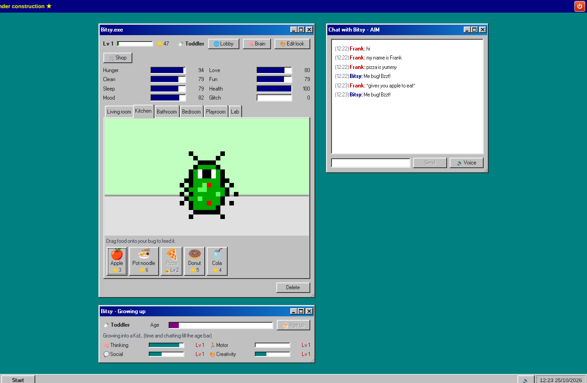
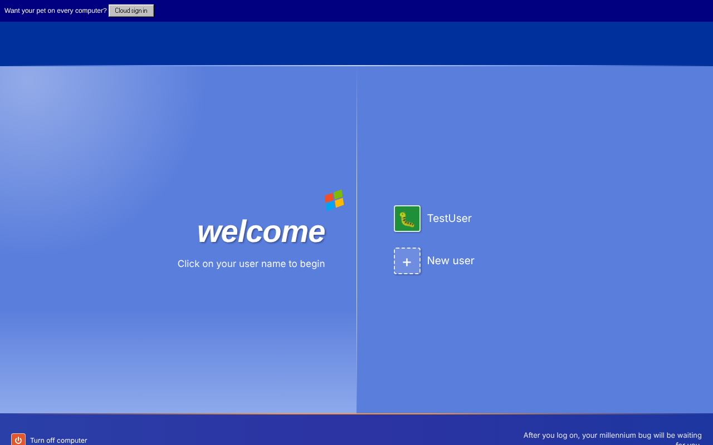
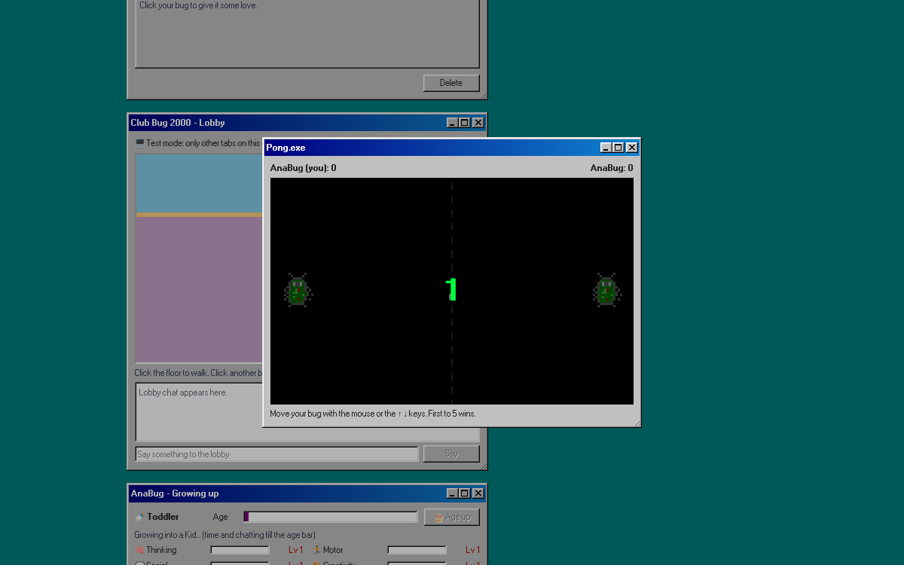
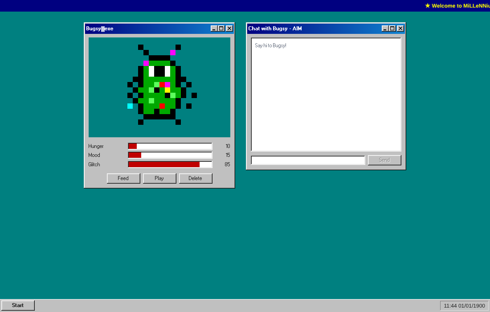

# 🐛 Millennium Bug

**An AI virtual pet that survived Y2K.** Built in 24 hours at **HackNotts '26** (theme: Y2K) by a team of four.

### ▶ [Play it live](https://millenium-bug-ashen.vercel.app)

No download or sign-up needed: open the link, enter a name and hatch your bug.



## What it is

Your pet is a *millennium bug* that crawled out of 1999. Feed it, clean it, play with it and talk to it, and it grows from a babbling toddler into an adult with its own personality. Neglect it and it starts to **glitch**: its words scramble, the clock breaks back to 1900 and the screen corrupts.

The whole thing lives inside a Windows 98-style desktop, complete with an XP-style log-on screen, draggable windows, a taskbar and retro sounds.

## Features

- **AI personality that learns.** Chat with your bug in an AIM-style window. It remembers your name, picks up new words and facts you teach it, and its tone reflects how well it has been looked after.
- **Needs and glitching.** Hunger, love, cleanliness, sleep, fun and health drop over time, even while you are away. Let them fall too low and the glitch meter climbs.
- **Rooms to care for it.** Living room, kitchen, bathroom, bedroom, playroom and lab, each with drag-and-drop items.
- **Growing up.** Four life stages (toddler, kid, teen, adult) with thinking, motor, social and creativity skills that level up.
- **Mini-games and coins.** Coin Catcher, Snake and head-to-head Pong earn coins to spend in the shop on food, potions, hats, glasses and wallpapers.
- **Pixel-art editor.** Draw your own 16x16 bug.
- **Multiplayer lobby.** Walk around a shared room, chat and visit other people's bugs in real time.
- **Accounts.** Local name log-on for instant play, plus optional cloud sign-in so your pet follows you between computers.
- **Voice.** Your bug can read its replies out loud.

| Log on | Pong | Neglected and glitching |
| --- | --- | --- |
|  |  |  |

## Tech stack

- **Next.js** (App Router), **TypeScript** and **Tailwind CSS**
- **98.css** for the Windows 98 look, and plain `<canvas>` for the games
- **Supabase** for accounts, cloud saves and real-time presence in the lobby
- **LLM chat** through a server-side `/api/chat` route (OpenRouter), with per-visitor rate limiting and built-in fallback replies so it never breaks mid-demo
- Deployed on **Vercel**

## Run it locally

```bash
npm install
cp .env.example .env.local   # optional: add OPENROUTER_API_KEY and Supabase keys
npm run dev                  # http://localhost:3000
npm test                     # unit tests for pet needs, glitching and the AI rate limit
```

Without any keys it still works: the pet answers with built-in lines and the lobby connects tabs on the same computer.

## Team

- **Frank Lynton:** lead developer, brought everything together into the live app
- **Kabir:** AI brain and API
- **Tanvir:** accounts and Supabase
- **Piyush:** sounds and music

Made at HackNotts '26, University of Nottingham.
